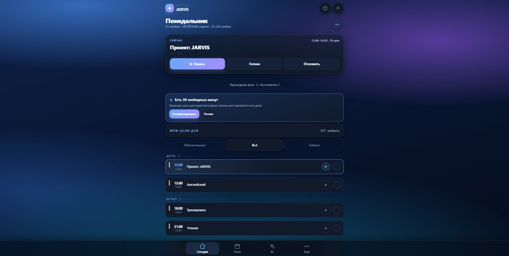
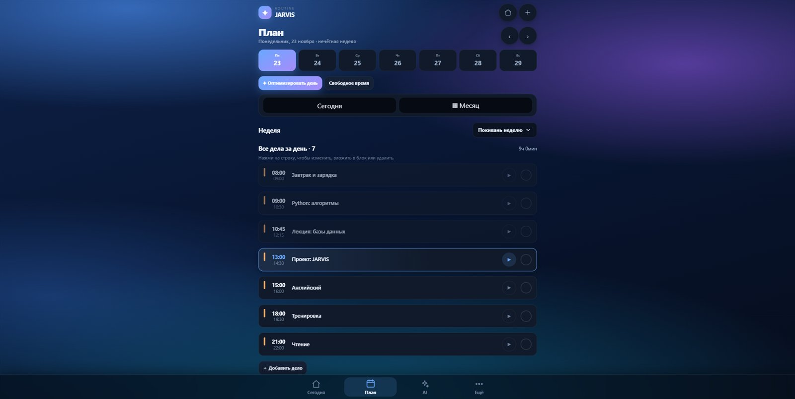
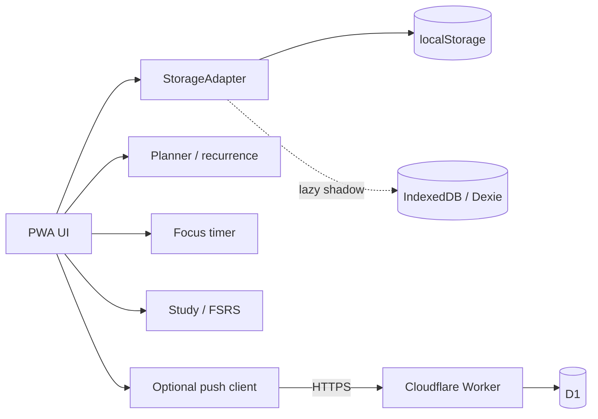

# JARVIS Routine

**A local-first weekly planner and focus companion that runs as a PWA.**

JARVIS Routine turns a personal weekly schedule into a calm daily view: today's blocks, free windows, goals, habits, focus sessions and study reviews. It works offline, stores everything on the device, and never ships the owner's real schedule in the source code.



> Screenshots use a synthetic demo schedule. The private template is not part of this repository.

## Features

- **Today view** — current and next block, free windows, day goals, habits and a "what to do now" queue.
- **Weekly planner** — 7-day and month views, drag/edit flows, repeat series, exceptions and pause rules.
- **Fast entry** — a deterministic Russian quick-add parser (`завтра 10:00 английский 45м`) and a `Ctrl/Cmd+K` command palette. No LLM is required for parsing.
- **Focus timer** — start a focus block from any task, track focused minutes, and re-plan the day around real free slots.
- **Habits, goals and study** — habit streaks, goal progress, a 12-week activity heatmap and an optional spaced-repetition Study tab (FSRS, with a Leitner fallback).
- **Local-first storage** — `localStorage` is the source of truth with versioned migrations and read-back verification; an IndexedDB shadow copy is written lazily.
- **Offline PWA** — service worker, installable on desktop and iPhone, dark premium UI.
- **Optional push** — a Cloudflare Worker + D1 backend for reminders and schedule delivery. Fully optional; the app stays useful without it.



## Stack

- Vanilla JavaScript modules, HTML, CSS — no runtime framework and no build step for the app shell
- `localStorage` + Dexie/IndexedDB shadow copy
- Service Worker / Web App Manifest
- Optional backend: Cloudflare Worker, D1, Web Push (VAPID)
- Dev tooling: Playwright, esbuild, Node test scripts

## Architecture



The app is plain ES modules under `site/`. The optional Worker lives in `backend/` with SQL migrations in `backend/migrations/`.

## Quick start

```bash
git clone https://github.com/Leis4/jarvis-routine.git
cd jarvis-routine

# serve the static PWA
python -m http.server 8080 --directory site
# or: npx serve site
```

Open <http://127.0.0.1:8080/>.

The first launch asks for a schedule template. This is intentional: the owner's real weekly schedule is private and is not bundled. Import your own JSON template or connect your own backend.

Optional backend:

```bash
cd backend
npm install
npx wrangler d1 migrations apply routine-db --local
npx wrangler dev
```

## Configuration

The frontend stores its optional backend URL and access token in the app settings (AI section). The Worker reads:

| Variable | Purpose |
|---|---|
| `APP_ACCESS_TOKEN` | Bearer token for the Worker API (secret) |
| `ALLOWED_ORIGIN` | Exact frontend origin allowed by CORS |
| `VAPID_PUBLIC_KEY` / `VAPID_PRIVATE_KEY` | Web Push keys |
| `VAPID_SUBJECT` | `mailto:` contact for push |
| `QWEN_BASE_URL` | Optional OpenAI-compatible endpoint for the assistant |

Never commit `.dev.vars`, tokens or VAPID private keys.

## Tests

```bash
node tests/site-syntax.mjs
python -m pytest tests -q
npx playwright test --config=playwright.config.js   # optional; needs browsers
```

The repository keeps a focused subset of the original test suite; browser tests require Playwright browsers to be installed.

## Status

Version 4.3, used daily by the author. The planner, recurrence, storage migrations, focus timer, habits, goals, study and heatmap are implemented. Cloud sync and push are optional and require your own Cloudflare account.

## Limitations

- Single-user by design; there is no account system.
- The private schedule template is intentionally not included.
- Push notifications need a deployed Worker, D1 and VAPID keys.
- The UI is optimised for a phone-width layout; desktop works but is secondary.

## Security and privacy

- No schedule, task history, push subscription or personal settings are committed.
- No analytics or third-party trackers are loaded by the app.
- The optional Worker only stores what you explicitly sync.

## AI-assisted development

Built with AI-assisted development (vibe-coding) under human direction: product decisions, UX review and acceptance were done by the author, while much of the implementation was produced with AI coding agents. Only features present in this repository are described.

## License

Original code: MIT — see [`LICENSE`](LICENSE). Vendored libraries keep their own licenses; see [`THIRD_PARTY_NOTICES.md`](THIRD_PARTY_NOTICES.md) and `site/vendor/third-party-licenses/`.
